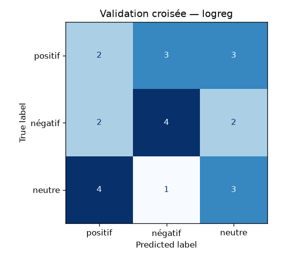
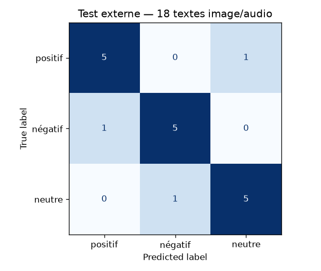
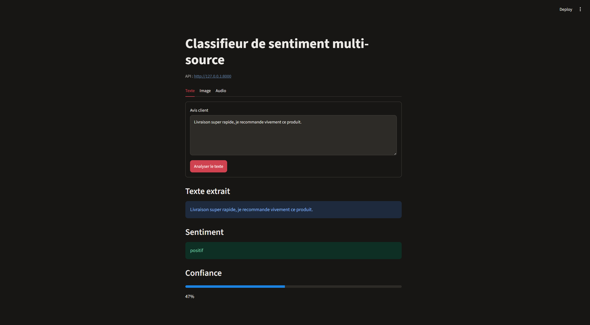
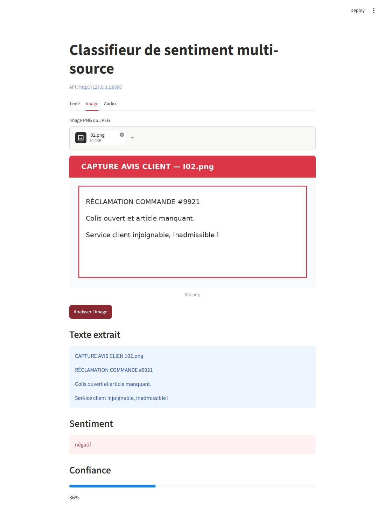
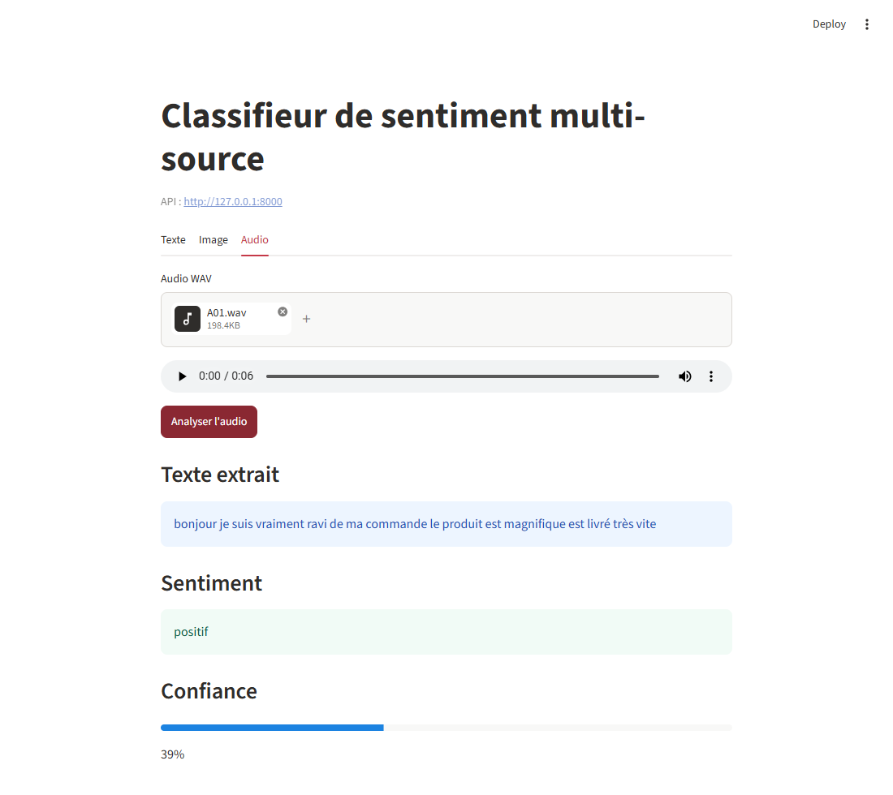
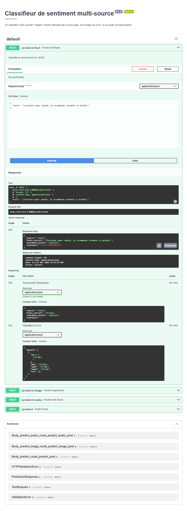
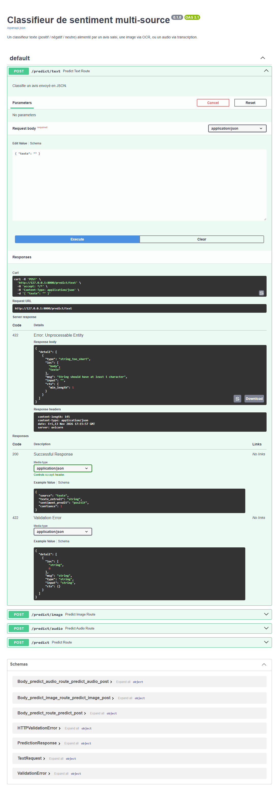

# Classifieur de sentiment multi-source

Un seul classifieur de texte (positif / négatif / neutre) reçoit trois sources. Un avis tapé part directement au modèle. Une image est lue par OCR (Tesseract, français), un audio WAV est transcrit (Google Speech Recognition, `fr-FR`), puis le même modèle décide. L'API FastAPI renvoie toujours la même forme de JSON. Une petite application Streamlit sert à tester les trois cas.

```
texte  ───────────────► classifieur TF-IDF + régression logistique ─► JSON
image  ─► OCR (fra) ──► classifieur ────────────────────────────────► JSON
audio  ─► ASR (fr-FR) ► classifieur ────────────────────────────────► JSON
```

Les étiquettes des CSV sont `positif`, `negatif`, `neutre`. L'API renvoie `négatif` (avec accent), comme demandé dans le sujet.

## Installation

Python 3.12.

```powershell
python -m venv .venv
.\.venv\Scripts\activate
pip install -r requirements.txt
```

Outils système, en plus de pip :

- [Tesseract OCR](https://github.com/UB-Mannheim/tesseract/wiki). L'installateur Windows ne contient souvent que l'anglais, et le dossier `Program Files` n'est pas toujours modifiable. Le fichier `tessdata/fra.traineddata` est donc dans le projet : `pipelines.py` pointe `TESSDATA_PREFIX` vers ce dossier. On peut aussi copier ce fichier dans le `tessdata` de Tesseract et définir `TESSERACT_CMD` si l'exécutable n'est pas à l'emplacement habituel.
- [ffmpeg](https://www.gyan.dev/ffmpeg/builds/), nécessaire une seule fois pour convertir les MP3 en WAV. `convert_audio.py` le cherche dans le `PATH` et dans l'installation WinGet.

Les WAV mono 16 kHz sont déjà dans `dataset_sentiment_ecommerce/audios/` (`A01.wav` … `A09.wav`), à côté des MP3 d'origine. Le CSV et le sujet parlent de `.wav`.

## Commandes

Depuis la racine du projet, avec le venv activé :

```powershell
python convert_audio.py          # seulement si les WAV n'existent pas
python train.py                  # entraîne, compare, écrit models/ et results/
uvicorn main:app --reload        # API : http://127.0.0.1:8000/docs
streamlit run app_streamlit.py   # application de test
pytest                           # 19 tests, sans internet
python evaluate_pipelines.py     # OCR + ASR réels, écrit results/pipeline_evaluation.csv
```

`API_URL` (défaut `http://127.0.0.1:8000`) indique à Streamlit où joindre l'API. L'API et Streamlit tournent dans deux terminaux.

## Modèle : résultats et justification

Entraînement sur les 24 textes de `textes.csv` (8 / 8 / 8). Nettoyage commun (`preprocessing.clean_text`) : minuscules, suppression de la ponctuation et des chiffres, stop-words français de NLTK, **sauf** les négations `ne`, `pas`, `ni`, `plus`, `sans`, `jamais`, `rien`, `aucun`. Vectorisation `TfidfVectorizer(ngram_range=(1, 2))`.

Un découpage 80/20 laisserait environ 5 lignes de test. L'évaluation interne est une validation croisée stratifiée : `StratifiedKFold(n_splits=4, shuffle=True, random_state=42)`.

| Modèle | Accuracy CV | F1 macro CV |
| --- | ---: | ---: |
| Régression logistique | 0.375 | 0.375 |
| LinearSVC | 0.375 | 0.375 |

Les deux modèles font le même score, à peine au-dessus du hasard (0.333). C'est attendu : 24 phrases courtes, vocabulaire creux, et la classe `neutre` est la plus difficile. Chaque pli n'apprend que sur 18 textes.

**Modèle retenu : la régression logistique.** À scores égaux, elle seule expose `predict_proba`, donc le champ `confiance`. Le SVM linéaire n'a pas de probabilités. Le vectoriseur et le modèle sont réentraînés sur les 24 textes et enregistrés dans `models/vectorizer.pkl` et `models/model.pkl`.

Test externe, honnête : les 18 textes de référence (`texte_attendu_ocr` et `transcription_reference`), jamais vus à l'entraînement.

| | Accuracy | F1 macro |
| --- | ---: | ---: |
| 18 textes de référence | 0.833 | 0.833 |

Le score monte parce que le modèle final a vu tout le vocabulaire des 24 avis. Ce n'est pas le score de la validation croisée. Trois phrases de référence sont quand même mal classées, et ce sont exactement les trois erreurs retrouvées plus bas dans le pipeline :

- `I01` : avis positif prédit `neutre`
- `I09` : confirmation neutre prédite `négatif`
- `A05` : avis négatif (« mécontent », « écrasé », « inutilisable ») prédit `positif`

Matrices et rapports : `results/cv_logreg_confusion.png`, `results/cv_linearsvc_confusion.png`, `results/external_confusion.png`, et les fichiers `.txt` à côté.





## Pipeline image et audio

`evaluate_pipelines.py` lance le vrai OCR et la vraie transcription Google, puis le classifieur. La similarité est le ratio de `difflib.SequenceMatcher` entre le texte extrait et la référence.

| Source | Sentiment correct | Similarité moyenne |
| --- | ---: | ---: |
| 9 images | 7/9 (77.8 %) | 0.844 |
| 9 audios | 8/9 (88.9 %) | 0.979 |

Le détail est dans `results/pipeline_evaluation.csv`. Les trois erreurs de sentiment sont celles du classifieur sur le texte de référence : l'OCR et l'ASR n'en sont pas la cause.

- Images : le texte utile est lu (accents compris). Le bandeau vert « CAPTURE AVIS CLIENT » est lu en plus, et les étoiles sont parfois transcrites `XX***`. Similarité autour de 0.80–0.87.
- Audios : similarité 0.92–0.99. Pour `A05.wav`, la transcription est quasi exacte (0.988) et le sentiment est quand même faux. L'erreur est dans le modèle, pas dans la reconnaissance vocale.

La transcription Google a besoin d'internet. Les tests `pytest` ne l'appellent pas : `transcribe_wav` est remplacée par une phrase fixe (`monkeypatch`), donc la suite passe hors ligne.

## API

`uvicorn main:app --reload`, documentation interactive sur http://127.0.0.1:8000/docs.

| Route | Entrée | Rôle |
| --- | --- | --- |
| `POST /predict/text` | JSON `{"texte": "..."}` | classifieur |
| `POST /predict/image` | multipart, champ `file` | OCR puis classifieur |
| `POST /predict/audio` | multipart, champ `file` | transcription puis classifieur |
| `POST /predict` | champ formulaire `texte` ou `file` | détecte la source |

Réponse unique :

```json
{
  "source": "texte",
  "texte_extrait": "Livraison super rapide, je recommande vivement ce produit.",
  "sentiment_predit": "positif",
  "confiance": 0.4698
}
```

`confiance` est la probabilité de la classe retenue. Avec 24 exemples elle reste souvent entre 0.35 et 0.50 : le modèle n'est pas sûr de lui, et le chiffre le montre.

Validation Pydantic :

- texte : 1 à 2000 caractères après suppression des espaces ; `" "` est refusé
- image : `image/png` ou `image/jpeg`, 1 octet à 5 Mo
- audio : `audio/wav`, `audio/x-wav` ou `audio/wave`, 1 octet à 10 Mo

Erreurs :

- corps invalide, mauvais type MIME, fichier vide ou trop gros, texte et fichier envoyés ensemble → **422**
- OCR ou ASR sans texte → **422** (`no text detected`)
- service Google injoignable → **503**

## Captures

Exécutions réelles de l'application et de Swagger.











## Limites

- 24 textes d'entraînement. La validation croisée (0.375) est le chiffre à citer pour la robustesse. Le test externe (0.833) est plus favorable parce que le modèle a vu tous les mots d'entraînement.
- `neutre` se confond avec les deux autres classes : une confirmation de livraison (`I09`) sort `négatif`.
- L'OCR dépend de l'image. Ici les captures sont propres, mais le bandeau et les étoiles ne sont pas dans le texte de référence.
- La transcription Google nécessite internet au moment de la démo audio.
- La confiance n'est pas calibrée : une prédiction `positif` peut n'avoir que ~0.47.

## Démo (~5 min)

1. Une phrase sur l'architecture : tout devient du texte, un seul modèle décide.
2. Streamlit : un texte, l'image `I02.png`, l'audio `A01.wav`. Montrer le texte extrait et la confiance.
3. Swagger : une requête valide, puis un corps vide pour obtenir un 422.
4. `pytest` en direct.

Questions courtes :

| Question | Réponse |
| --- | --- |
| Pourquoi une cascade ? | Un seul modèle à entraîner. L'OCR et l'ASR existent déjà. |
| Que fait TF-IDF ? | Il augmente le poids d'un mot fréquent dans l'avis et rare dans l'ensemble des avis. |
| Pourquoi la logistique plutôt que le SVM ? | Même score ici, mais elle donne une probabilité, donc `confiance`. |
| Pourquoi la validation croisée ? | 24 lignes : un split laisse ~5 tests. La CV teste chaque ligne une fois. |
| Pourquoi garder « pas » et « ne » ? | La négation inverse le sentiment. Les retirer transforme « ne fonctionne pas » en « fonctionne ». |
| Où le pipeline casse ? | Mauvais texte extrait, ou bon texte et mauvais modèle. Le CSV d'évaluation sépare les deux. Ici les 3 erreurs sont le modèle. |
| Comment les fichiers sont validés ? | Un modèle Pydantic sur le type MIME et la taille, sinon 422. |
| 422 ou 500 ? | 422 : le client a envoyé quelque chose d'invalide. 500 : bug du serveur. |
| Comment améliorer le modèle ? | D'abord plus de textes étiquetés. Ensuite seulement un autre modèle. |
